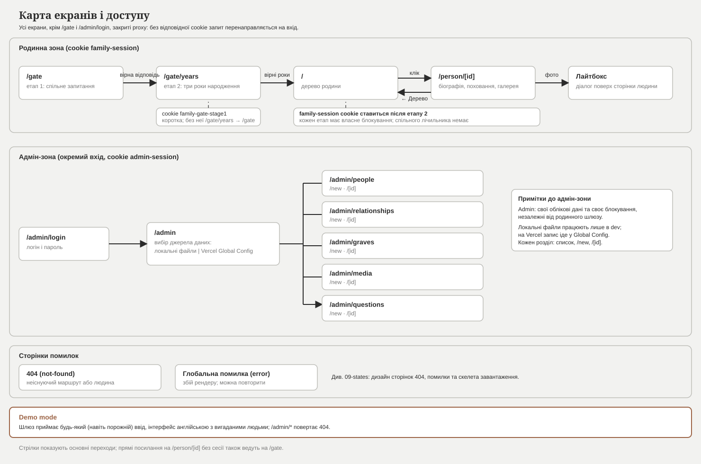
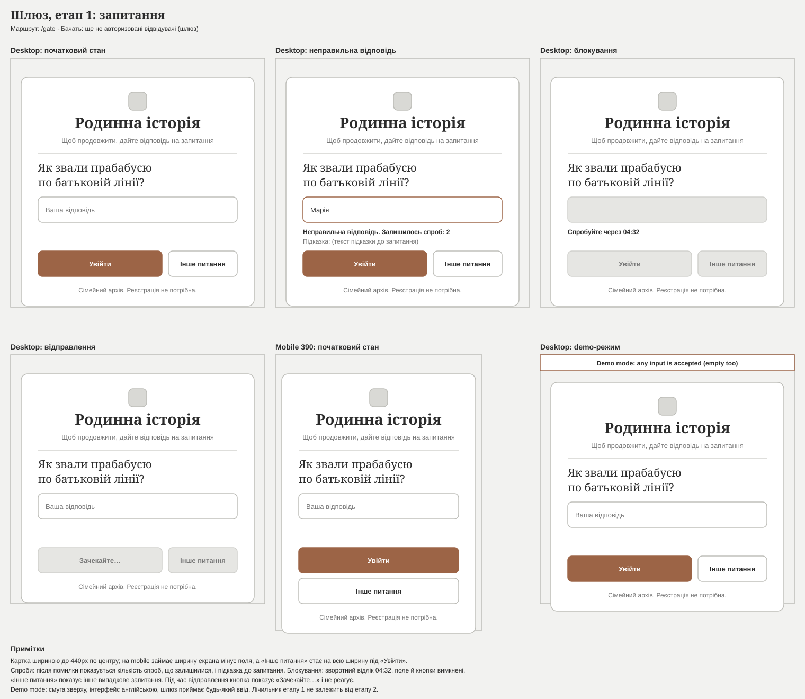
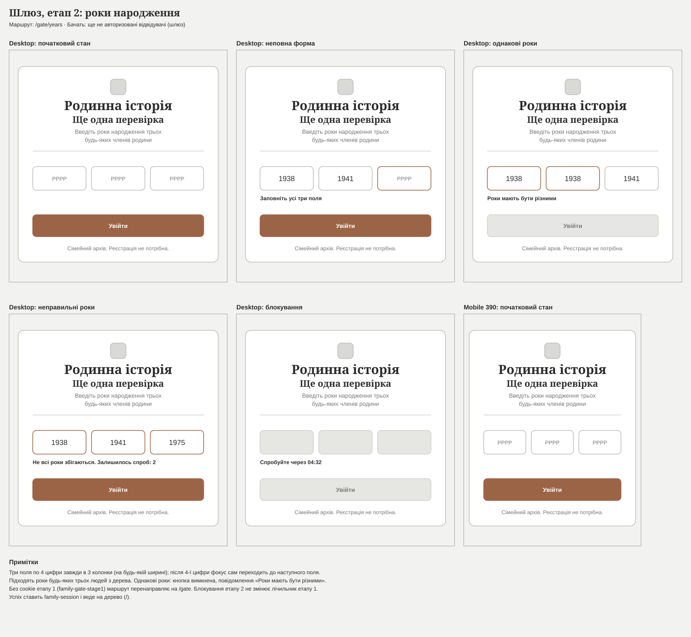
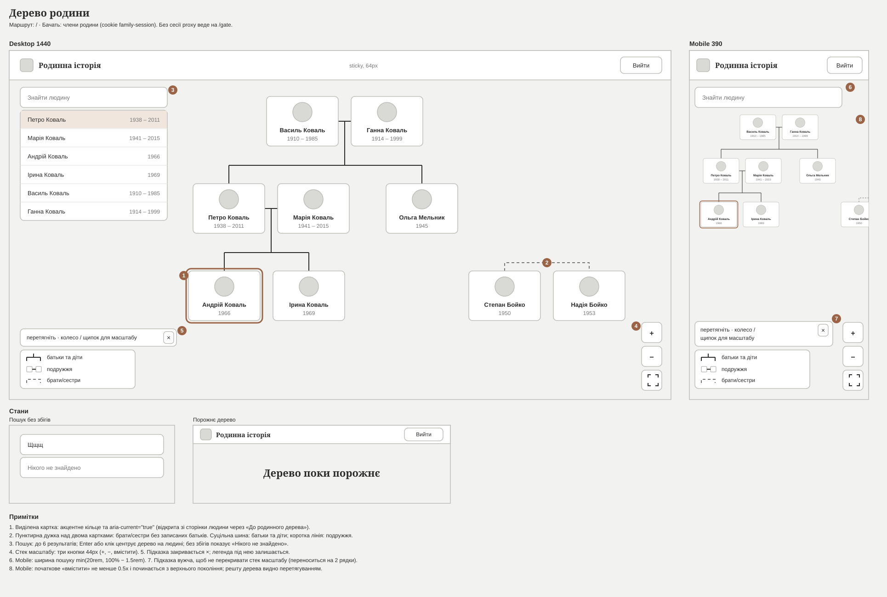
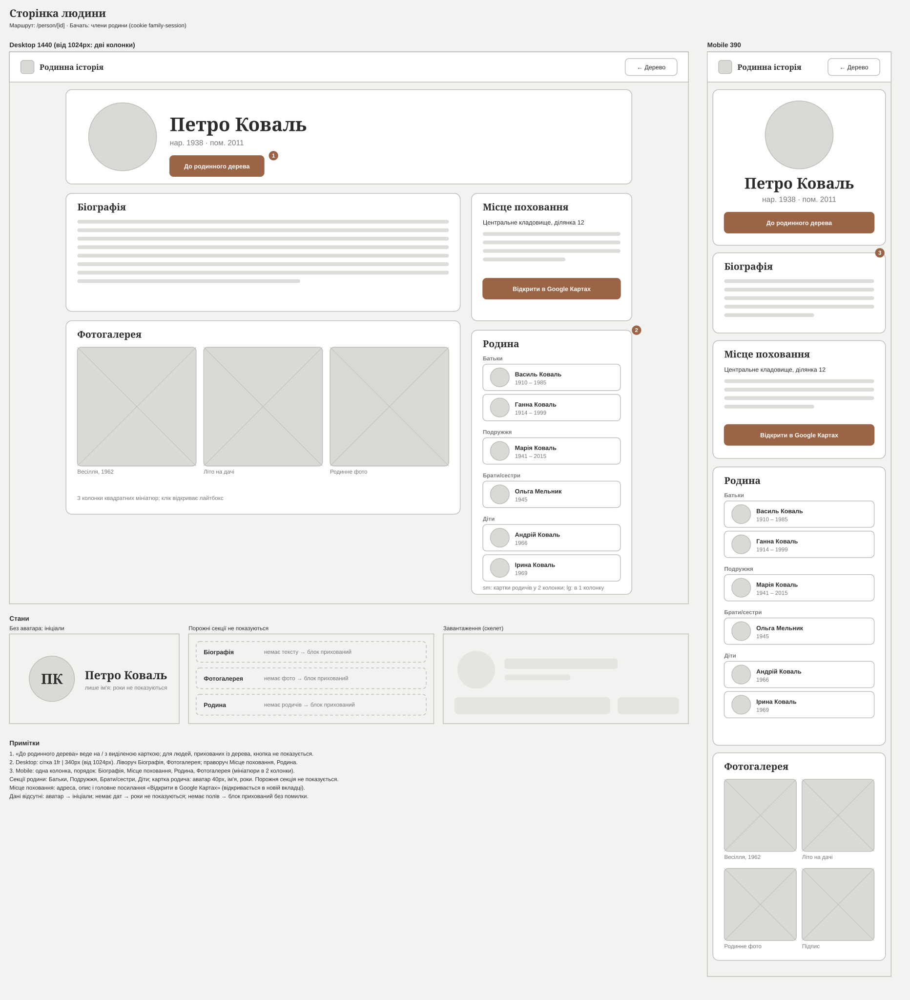
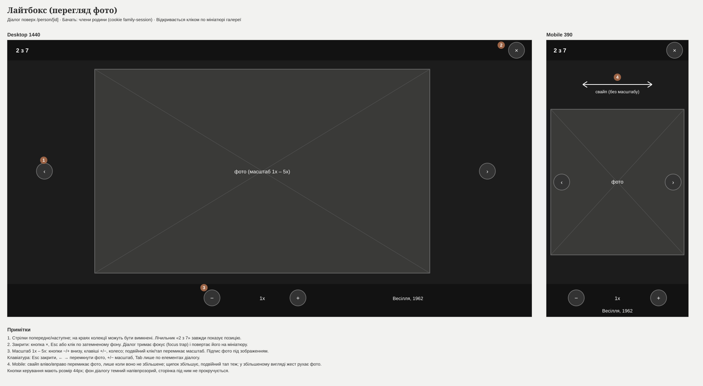
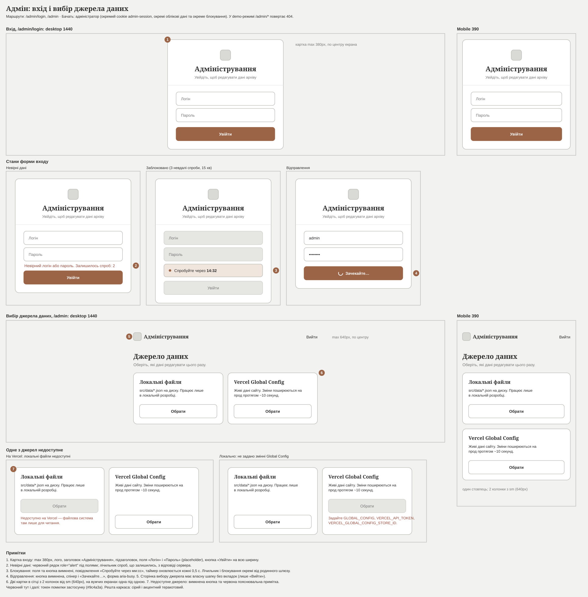
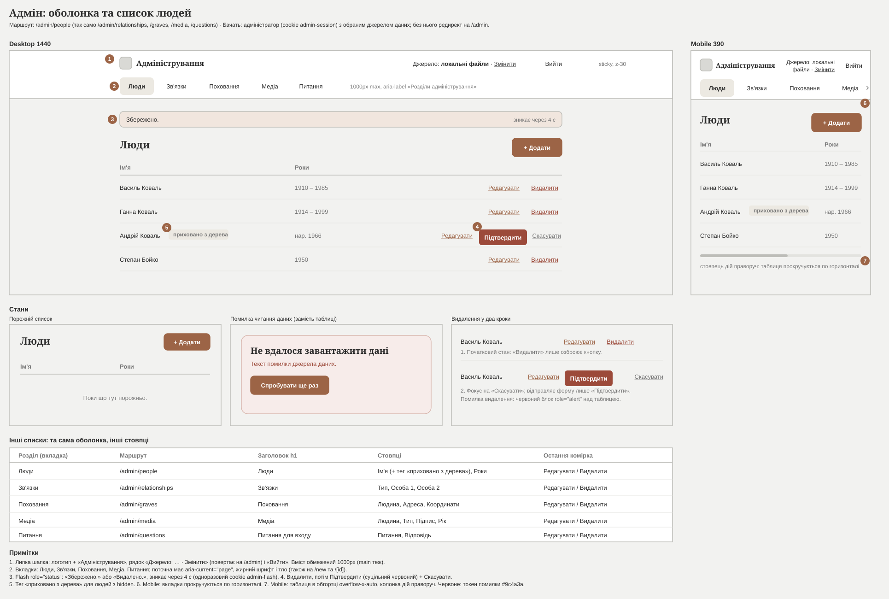
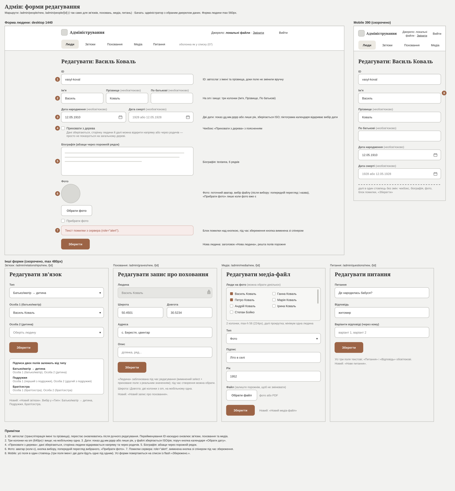
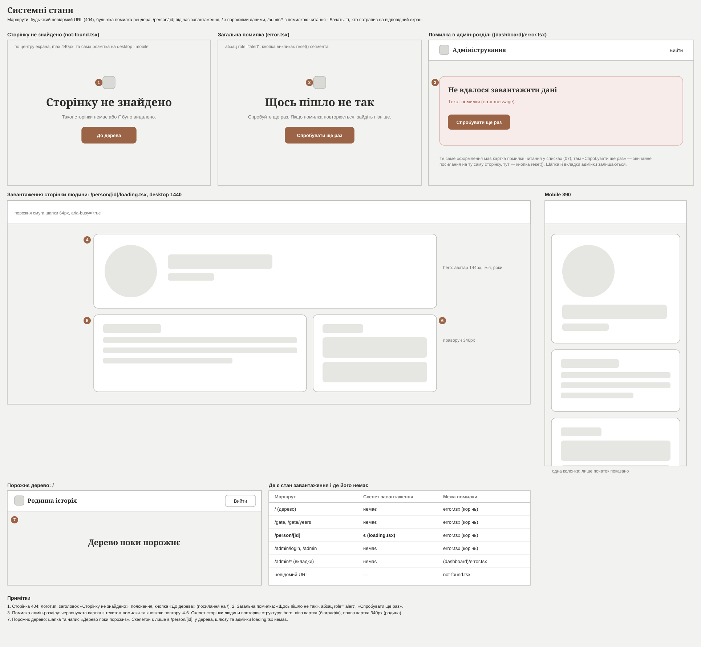

# Wireframes

Low-fidelity wireframes of every screen of «Родинна історія». They document the **current implementation** (structure, hierarchy, states and copy), not a redesign. UI copy inside the images is Ukrainian, matching `messages/uk.json` and the literal strings in `src/app/admin`.

Each file shows a desktop frame (1440) and, where the layout differs, a mobile frame (390). Numbered terracotta circles are callouts, explained in the "Примітки" block at the bottom of each image.

## Index

### 00 Sitemap

- Routes: all (`/gate`, `/gate/years`, `/`, `/person/[id]`, `/admin/*`)
- Who sees it: documentation of access: family session vs. separate admin session
- Shows: the flow gate stage 1, stage 2, tree, person; the separate admin login, data source and five admin sections; demo mode note (admin returns 404)

### 01 Gate, question

- Route: `/gate`
- Who sees it: anyone without a `family-session` cookie
- States: idle, wrong answer with attempts left and hint, locked with countdown

### 02 Gate, birth years

- Route: `/gate/years`
- Who sees it: visitors who passed stage 1 (short-lived `family-gate-stage1` cookie)
- States: three year inputs, duplicate (disabled button), wrong, locked

### 03 Family tree

- Route: `/`
- Who sees it: family members (`family-session`)
- States: desktop and mobile, search with results and no matches, zoom stack, hint, legend, highlighted card, the three connector types, empty tree

### 04 Person page

- Route: `/person/[id]`
- Who sees it: family members
- States: desktop two columns (biography and gallery | burial and family), mobile stack order, hero with avatar and "Відкрити родовід", family sections

### 05 Lightbox

- Route: opened from the gallery on `/person/[id]`
- Who sees it: family members
- States: top bar, zoomable image, prev/next, zoom controls and caption, mobile swipe

### 06 Admin entry

- Routes: `/admin/login`, `/admin`
- Who sees it: the administrator (separate `admin-session` cookie, separate credentials and lockout); `/admin/*` is a 404 in demo mode
- States: login idle, invalid (with attempts left), locked countdown, submitting; data source picker (own header, two cards) and variants with one source unavailable

### 07 Admin list

- Routes: `/admin/people` (same shell for `/relationships`, `/graves`, `/media`, `/questions`)
- Who sees it: the administrator with a selected data source
- States: sticky header with source line, five-tab nav, flash notice, people table, two-step delete, empty list, read-error card, horizontal scroll on mobile; a table of the column sets of the other lists

### 08 Admin forms

- Routes: `/admin/people/new`, `/admin/people/[id]` and the equivalents for relationships, graves, media and questions
- Who sees it: the administrator
- States: person form (auto-slug ID, name row, dates, hidden checkbox, bio, photo picker, error box), mobile single column, compact variants of the other four forms

### 09 System states

- Routes: any unknown URL, any render error, `/person/[id]` while loading, `/` with no data, `/admin/*` with a failing read
- Who sees it: whoever lands on the state
- States: not found, global error, person loading skeleton, empty tree, admin dashboard error; a table of which routes have no loading/skeleton (tree, gate, admin)

## Design tokens

Taken from `src/app/globals.css`. The wireframes themselves use a greyscale palette plus the terracotta accent; the real tokens are listed for reference.

| Token | Value |
| --- | --- |
| cream (page) | `#f6f0e4` |
| surface / surface-muted / surface-hover | `#fffdf8` / `#fbf6ea` / `#f1e9d8` |
| border / border-strong / border-divider | `#ece2ce` / `#e3d8c0` / `#e8dec9` |
| terracotta (accent) / hover | `#9c6446` / `#8a5739` |
| ink / muted | `#35291d` / `#6f6350` |
| error | `#9c4a3a` |
| notice | `#f7ede0` |
| Fonts | Literata (serif, headings), Nunito Sans (sans, body) |
| Radii | xl 22, lg 16, md 14, sm 12, xs 10 px |
| Text sizes | caption 13, small 14.5, body 16.5, display 40 px |

The SVGs use Arial and Georgia as stand-ins so they render the same everywhere.

## Conventions

- Greyscale boxes on a light ground; one accent, terracotta `#9c6446`, for primary actions and the highlighted element. Red (`#9c4a3a`) appears only for errors and destructive actions.
- Numbered callouts (terracotta circles) refer to the "Примітки" block under each image.
- Frames: desktop 1440, mobile 390. Breakpoints: `sm` 640, `lg` 1024.
- Sizes follow the real components (tree card 156x108, gate card 440 max, admin main 1000 max, admin login card 380 max, person two-column split at `lg` with a 340px right column).

## How to edit

The files are plain SVG: open them in a browser to preview, edit them in any text editor. Every file starts with the same `<style>` block (classes `box`, `card`, `btn`, `btn-primary`, `input`, `muted`, `note`, ...). If you change it, change it in all ten files so they stay consistent. Keep the real Ukrainian strings in sync with `messages/uk.json` and `src/app/admin`.

## Note

These wireframes describe the current implementation. When a screen changes, update the matching file in the same change.
